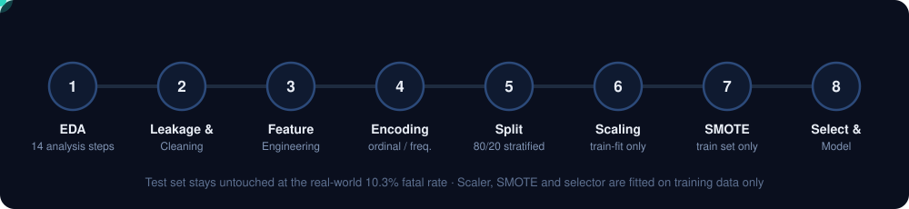

<div align="center">



<br/>


**An end-to-end, leakage-free machine learning system that predicts fatal drug adverse events using the FDA Adverse Event Reporting System (FAERS).**

[The Problem](#-the-problem) · [Objective](#-objective) · [The Solution](#-the-solution) · [Results](#-results) · [Dashboard](#-interactive-dashboard) · [Getting Started](#-getting-started)

</div>

---

## 📌 At a Glance

| 528,000 | 10.3% | 5 | 0.8414 |
|:---:|:---:|:---:|:---:|
| FAERS reports (2015–2026) | Fatal cases (54,384) | Models benchmarked | Best ROC-AUC (Random Forest) |

---

## 🚨 The Problem

Every year, regulators receive hundreds of thousands of reports of suspected drug side effects. **FAERS** is the FDA's public post-market surveillance database, and it is the first line of defense for catching medication safety issues after a drug is on the market.

The challenge is that this data is:

- **Overwhelming in volume.** Safety reviewers cannot manually triage every report to find the ones that matter most.
- **Extremely imbalanced.** Only about **1 in 10** reports describes a fatal outcome, so naive models learn to say "not fatal" and still look 90% accurate.
- **Messy.** Placeholder strings hide real missing values, columns have thousands of unique categories, and numeric fields contain impossible values (for example, 2,108 concurrent drugs in one report).
- **Full of hidden target leakage.** Many columns (`serious`, `serious_flags`, `reaction_outcomes`, ...) *are* the answer in disguise. Models trained on them produce near-perfect but completely meaningless scores.

> **How do we reliably flag the reports most likely to involve a fatal outcome, without cheating?**

---

## 🎯 Objective

Build an **honest, reproducible binary classifier** that predicts `is_fatal` from patient, drug, and report characteristics, and make it explorable through an interactive dashboard.

| # | Goal | How we measure it |
|:-:|------|-------------------|
| 1 | Detect and remove every source of target leakage | Systematic leakage audit in EDA (Step 10) |
| 2 | Handle severe class imbalance correctly | SMOTE on training data only; test set keeps the real 10.3% rate |
| 3 | Engineer clinically meaningful features | 7 domain-driven features, each validated by fatal-rate lift |
| 4 | Benchmark linear, tree, bagging and boosting models | Accuracy, Precision, Recall, F1, **ROC-AUC** (primary) |
| 5 | Communicate findings to non-technical stakeholders | Streamlit dashboard with 8 interactive pages |

---

## 💡 The Solution

MediGuard AI is a full pipeline, from raw reports to a ranked risk model, built so that **every step avoids information leakage**.

<div align="center">

</div>

### 1. Exploratory Data Analysis (14 systematic steps)
Structural inspection, duplicate detection, missing-value audit, distributions, outliers, temporal drift, correlation, and a dedicated **leakage check** that proved `serious = No` always implies every fatal/hospitalized/life-threat/disabling flag is `False`.

### 2. Leakage-safe preprocessing
- Dropped **7 leakage columns** and **9 redundant columns** (including `patient_weight_kg`, 72% missing).
- Converted masked missingness (`"Unknown"`, `"Product Used For Unknown Indication"`) into real `NaN`.
- Capped `num_reactions` and `num_drugs` at the 99th percentile (rows preserved).
- Removed the literal term `"Death"` from `primary_reaction` (9,371 rows), since it directly encodes the target.

### 3. Clinically motivated feature engineering

| Feature | Logic | Fatal rate (0 → 1) | Lift |
|---|---|:---:|:---:|
| `is_elderly_polypharmacy` | Age 66+ **and** 6+ drugs | 9.20% → 18.27% | **+98.6%** |
| `is_covid_year` | Report year = 2020 | 9.54% → 17.73% | **+86%** |
| `is_multi_reaction` | More than 3 reactions | 7.8% → 12.4% | +59% |
| `is_polypharmacy_high` | 6+ concurrent drugs | 8.9% → 13.1% | +47% |
| `is_high_risk_route` | IV, IM, intrathecal, intracardiac, ... | 9.8% → 14.3% | +46% |
| `is_us_report` | Country = US | 10.1% → 10.6% | +5% |
| `reaction_drug_ratio` | `num_reactions / max(num_drugs, 1)` | continuous | r = +0.08 |

### 4. Encoding, splitting, scaling and balancing
- **Ordinal** encoding for `age_group`, label mapping for `patient_sex`, numeric FDA codes for `drug_route`.
- **Frequency encoding** for `suspect_drug` (9,828 unique values) and `primary_reaction` (10,446 unique values), which avoids one-hot explosion without using the target.
- **80/20 stratified split**, then `StandardScaler` fitted on train only.
- **SMOTE on the training set only**: 422,400 → 757,918 rows, class balance 10.3% → 50%.
- **Two-stage feature selection:** `VarianceThreshold` followed by `SelectKBest(f_classif, k=16)`.

<div align="center">

</div>

### 5. Model benchmarking
Five models trained on the balanced training set and evaluated on the **untouched, real-distribution test set** (105,600 reports):

`Logistic Regression` (linear baseline) → `Decision Tree` → `Random Forest` → `XGBoost` → `LightGBM`

---

## 🏆 Results

<div align="center">

</div>

| Rank | Model | Accuracy | Precision | Recall | F1 | ROC-AUC |
|:---:|---|:---:|:---:|:---:|:---:|:---:|
| 🥇 | **Random Forest** | 0.8125 | 0.3054 | 0.6457 | 0.4147 | **0.8414** |
| 🥈 | XGBoost | 0.9010 | 0.5251 | 0.3885 | 0.4466 | 0.8380 |
| 🥉 | LightGBM | 0.8981 | 0.5061 | 0.3755 | 0.4311 | 0.8212 |
| 4 | Decision Tree | 0.6396 | 0.1889 | 0.7603 | 0.3026 | 0.7703 |
| 5 | Logistic Regression | 0.6343 | 0.1630 | 0.6184 | 0.2580 | 0.6764 |

### How to read these numbers

- **Why ROC-AUC is the primary metric.** A model that always predicts "Not Fatal" scores ~89.7% accuracy while catching zero deaths. ROC-AUC measures how well fatal cases are *ranked* above non-fatal ones, regardless of threshold or class ratio.
- **Random Forest wins** with the best ranking ability and a strong recall (it catches ~65% of fatal reports), at the cost of lower precision than the boosting models.
- **XGBoost is the precision pick.** More than 1 in 2 of its fatal flags is correct, but it misses more fatal cases (recall 0.39). Choose it when false alarms are expensive; choose Random Forest when missing a fatal case is worse.
- **No model gets both high precision and high recall.** That reflects the real difficulty of the task: fatal reports are rare and look very similar to non-fatal ones.

### Key findings

1. **Removing leakage was the single most important step.** Keeping the leaky columns would have produced near-perfect, entirely fake scores.
2. **SMOTE was essential**, and only valid because it was applied *after* the split.
3. **Domain features carry real signal.** Elderly patients on 6+ drugs have almost double the fatal rate.
4. **2020 was a structural break.** The fatal rate jumped 86% (17.73% vs 9.54%), plausibly from experimental treatments, overwhelmed hospitals and higher-risk patients.

---

## 🖥️ Interactive Dashboard

`mediguard_app.py` is a dark-themed **Streamlit** app that walks through the entire project across 8 pages:

| Page | What you get |
|---|---|
| 🏠 Overview | KPIs, pipeline architecture, target distribution |
| 🔬 Data & EDA | Dataset structure, missing-value audit, distributions, leakage detection |
| ⚙️ Preprocessing Pipeline | All 11 steps with the exact code for each |
| 🧬 Feature Engineering | Each engineered feature with rationale and fatal-rate lift charts |
| 🤖 Model Training | Hyperparameters, strengths and limitations per model |
| 📊 Model Comparison | Radar chart, grouped bars, results table, feature importances |
| 🎯 Risk Predictor | Interactive patient-profile simulator with risk gauge and factor breakdown |
| 📋 Conclusions | Findings, limitations, future work, final scorecard |

> **Transparency note:** the **Risk Predictor** page is an educational, rule-based approximation of the patterns found by the model. It does **not** load the trained Random Forest. The ROC curves and feature-importance chart on the *Model Comparison* page are illustrative visualizations built from the reported metrics. The real evaluation plots are generated inside the notebook.

---

## 🚀 Getting Started

### 1. Clone and install

```bash
git clone https://github.com/<your-username>/<your-repo>.git
cd <your-repo>
python -m venv .venv && source .venv/bin/activate   # Windows: .venv\Scripts\activate
pip install -r requirements.txt
```

### 2. Run the dashboard

```bash
streamlit run mediguard_app.py
```

### 3. Reproduce the modeling

1. Obtain the cleaned FAERS dataset and place it in the project root as `fda_adverse_events_2015_2026_CLEAN.csv`
   *(the file is not included in this repository because of its size)*.
2. Open `Project_Predictive_Analytics_Final__234190_.ipynb` in Jupyter or Colab.
3. Update `DATA_PATH` in the first code cell and run all cells.

---

## 📁 Repository Structure

```text
.
├── assets/                                        # Animated SVGs used in this README
│   ├── banner.svg
│   ├── pipeline.svg
│   ├── key_insights.svg
│   └── model_performance.svg
├── Project_Predictive_Analytics.ipynb   # Full analysis: EDA → modeling → interpretation
├── mediguard_app.py                               # Streamlit dashboard
├── requirements.txt
└── README.md
```

---

## ⚠️ Limitations

- **Voluntary-reporting bias.** FAERS is not a random sample of all adverse events, and US reports dominate (~60%).
- **72% missing patient weight.** A critical dosage and toxicity factor had to be excluded entirely.
- **Artificial stratification.** The dataset contains exactly 48,000 reports per year, which distorts true temporal volume patterns.
- **Label noise.** Fatality is reporter-assessed, not confirmed by death certificates; some deaths may stem from the underlying disease rather than the drug.
- **Association is not causation.** FAERS reports record *suspected* links. This model predicts risk patterns, not causal drug effects.

## 🔭 Future Work

- [ ] Tune the decision threshold below 0.5 to trade precision for recall on fatal cases
- [ ] Try target encoding for `suspect_drug` and `primary_reaction` (with proper cross-validation)
- [ ] Add **SHAP** values for instance-level explainability
- [ ] Calibrate probabilities (Platt scaling or isotonic regression)
- [ ] Hyperparameter search for LightGBM and XGBoost
- [ ] Serve the trained model in the dashboard instead of the rule-based demo
- [ ] Incorporate dosage and comorbidity data where available

---

## ⚕️ Disclaimer

This project is for **analytical and educational purposes only**. It is not a medical device and must not be used for clinical decision-making. FAERS reports indicate suspected associations and do not confirm causation.

## 👤 Author

**Mina Magdy** · [LinkedIn](https://www.linkedin.com/in/mina-magdy-data-analyst/?isSelfProfile=true) · [GitHub](https://github.com/Mina-Magdy-22)

<div align="center">

<sub>If you found this project useful, consider giving it a ⭐</sub>

</div>
